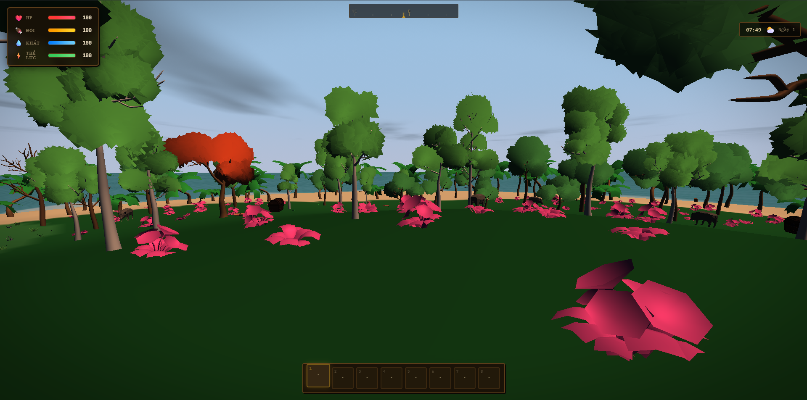
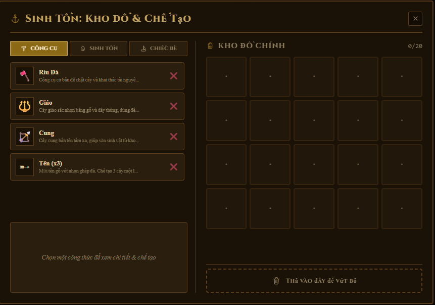
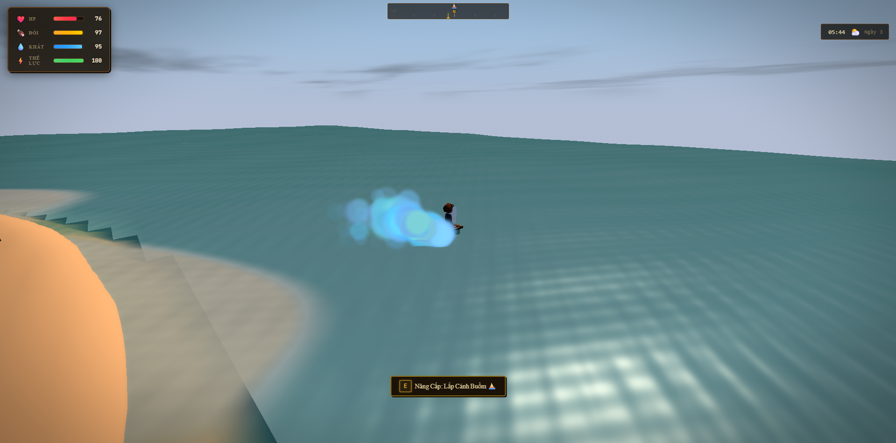

# Island Survival: Escape

Island Survival: Escape is a browser-based first-person survival game built with WebGL 2 and vanilla JavaScript. Explore a procedurally generated tropical island, manage your condition, gather resources, craft a raft, and escape before the island defeats you.

The **2.0 Campaign is in development**: new worlds default to a 640 m island with six chapters, modular bases, shared chests, fuelled production, farming, diving, field repairs and two controllable endings. Existing worlds remain Classic. The target of several real-day sessions and 8–12 active hours is **not yet validated by first-time human playtests**. Implementation and acceptance evidence: [progress](tasks/implementation-progress.md), [update roadmap](tasks/update-roadmap.vi.md), [player guide in Vietnamese](tasks/player-guide.vi.md).



## Highlights

- Explore a seeded procedural island with beaches, forests, rocky areas, caverns, and a waterfall.
- Gather island materials and recover drifting debris from the sea.
- Craft tools, survival supplies, and the three parts required to build a raft.
- Manage health, hunger, thirst, and stamina through changing weather and the day-night cycle.
- Encounter crabs, seagulls, boars and sharks, plus deer, mountain goats and monitor lizards in new Campaign worlds.
- Explore new Campaign jungle, coastal mangrove and savanna regions with stilt-root mangrove trees and umbrella acacias. See [biome expansion notes](docs/BIOME_EXPANSION.vi.md).
- Create private online rooms and keep worlds and individual characters on your own LAN/self-hosted server.
- Unlock persistent achievements as you progress.



## Goal

Your objective is to escape the island. Collect materials, craft a Raft Frame, Barrel Floats, and a Paddle, then install them at the shoreline raft site and launch your escape.

That three-part route describes **Classic**. In **Campaign**, follow the chapter journal through the mine, weather station and submerged wreck. Prepare either the equipped sailing raft or the radio/signal tower, then complete its real-time challenge. Checkpoints permit retry, and returning after an ending preserves the same world for the other route. Use the journal and departure panel for current prerequisites.

## Requirements

- Node.js 20.19 or later, or Node.js 22.12 or later
- npm
- A modern desktop browser with WebGL 2 support

## Getting Started

The main menu offers **CHƠI ĐƠN** (offline, local saves) and **NHIỀU NGƯỜI CHƠI** (LAN/self-hosted servers). For offline play, install and run the local web app:

```bash
npm ci
npm run dev
```

Offline play does not connect to a multiplayer server. Existing local worlds and saves remain available. `npm start` also runs only the game client. To build and preview the production game:

```bash
npm ci
npm run build
npm run preview
```

Multiplayer uses a **separate Dedicated Server**, run by whoever wants to host. In the full checkout, start it in another terminal with `npm run server`; no client build is required. Export the standalone distributable with `npm run build:server`, then share `dist-server/island-survival-dedicated-server-1.0.0.tgz`. After extraction, the host runs `npm ci --omit=dev` and `npm start` inside its `package` folder, or uses `start-server.cmd` on Windows. The package contains no game assets or frontend build.

Players open the game client (`http://localhost:5173` during development, or your separately hosted game website), choose **NHIỀU NGƯỜI CHƠI**, and enter the dedicated server address, e.g. `192.168.1.10:3000`. There is no assumed server at the game website's address. A room code is optional. Multiplayer saves live on the host in `server-data/`; rejoin from the same browser and server address to recover your character. No third-party multiplayer service is required.

Full Vietnamese instructions for LAN, passwords, Docker, Internet hosting and current co-op limitations: [MULTIPLAYER.vi.md](docs/MULTIPLAYER.vi.md). For development, run `npm run server:dev` and `npm run dev` in separate terminals.

## Production Build

Create and preview an optimized client build:

```bash
npm run build
npm run preview
```

The production client output is written to `dist/` and can be deployed on static hosting independently of the Dedicated Server. The multiplayer server listens on TCP 3000 for WebSocket `/ws` and health checks; it does not serve the game website. The client build copies only models and manifests referenced at runtime; source textures, Blender/FBX files, and unused character variants are not shipped.

## Controls

| Input | Action |
| --- | --- |
| W, A, S, D | Move |
| Shift | Sprint while stamina is available |
| Mouse | Look around while the pointer is locked |
| Left mouse button | Attack or chop with the equipped weapon |
| Mouse wheel | Select a hotbar slot |
| E | Interact, collect, or install raft parts |
| Tab or C | Open or close inventory and crafting |
| Q | Use or place the active item |
| B (Campaign) | Open construction; R rotates the selected part |
| J / M (Campaign) | Chapter journal / explored map |
| Space / Ctrl (Campaign, in water) | Swim up / dive down |
| Esc | Pause and release the pointer |
| L | Lock the mouse cursor for direct camera look |
| Escape | Pause the game |
| F3 | Toggle the debug panel |
| K | Developer-only cheat while running the Vite development server |

Movement, interaction, inventory and hotbar bindings can be changed in Settings. Controls also include **Giảm chuyển động**, which suppresses camera/hand bob and sprint FOV changes and respects the OS reduced-motion preference. Campaign panels support keyboard focus; the map uses arrow keys, Shift+arrows, Home and Enter/Space for markers.



## Crafting Path

The table below describes the original Classic route. The complete effective Campaign list is generated from runtime data in [recipe-catalogue.vi.md](tasks/recipe-catalogue.vi.md); regenerate it with `node scripts/document-campaign-recipes.mjs` after changing recipes or structures.

| Item | Materials | Purpose |
| --- | --- | --- |
| Stone Axe | 2 Wood, 2 Stone | A progression tool and tutorial milestone |
| Raft Frame | 10 Wood | The structural foundation of the raft |
| Barrel Floats | 3 Barrels, 1 Rope | Buoyancy for the raft |
| Paddle | 5 Wood, 2 Rope | The final raft component required to escape |

## Testing

Audio is played from downloaded files in `assets/audio/`, with three music moods,
surface footsteps, combat/UI cues, weather, wildlife, campfire and waterfall loops.
Sources, authors and CC0 / CC BY 3.0 attribution are listed in
[audio credits](assets/audio/CREDITS.md); per-file provenance is in `assets/audio/manifest.json`.
The production build includes all referenced audio and credits. To download and
prepare the library again, run `npm run assets:audio` (Python, `py7zr` and FFmpeg required).
Run `npx playwright test tests/browser/audio.spec.js` to verify browser decoding,
playback, mood transitions, volume/mute settings and cancellation during loading.

Run the automated test suite with:

```bash
npm test
```

## Project Structure

```text
assets/       Runtime models/manifests plus source asset library
docs/         Game design, technical documentation, and image placeholders
scripts/      Asset and build helper scripts
src/          Engine, rendering, gameplay, UI, and world-generation source code
tests/        Automated Node.js tests
index.html    Canvas container and UI markup
index.css     Game interface styles
```

## Documentation

- `docs/GDD.md` describes the game vision and core loop.
- `docs/GAME_RULES.md` covers gameplay rules and controls in detail.
- `docs/SYSTEMS.md` documents the main technical systems.
- `docs/FOLDER_STRUCTURE.md` provides a detailed source layout.

## Adding Screenshots

Add image files to `docs/images/` using the filenames referenced above, or update the paths in this README. Use landscape screenshots at a 16:9 ratio where possible so the project page remains consistent.
