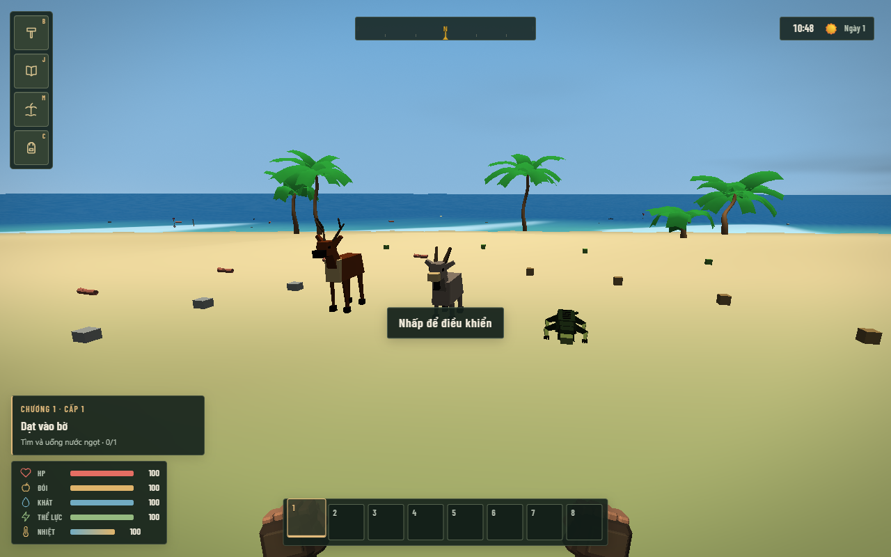
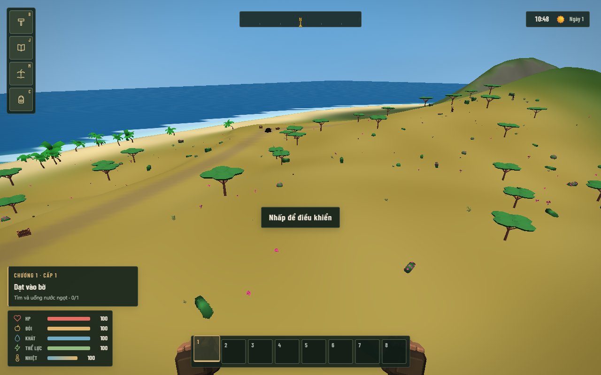
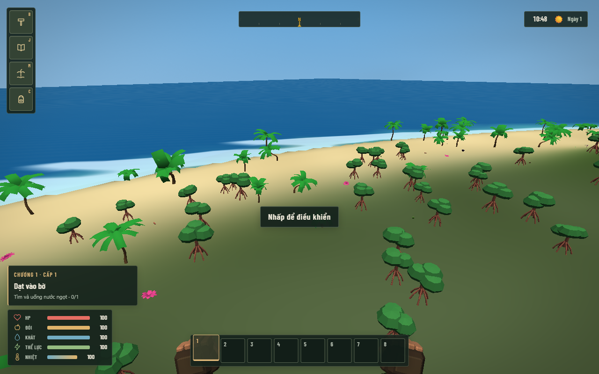
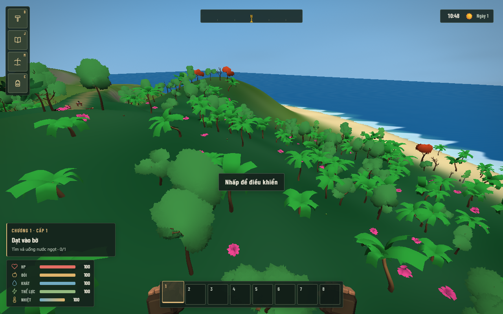

# Biome và động vật mở rộng

Tạo **thế giới Campaign mới** để chơi bản tạo đảo 3. Campaign cũ tiếp tục dùng bản 2;
Classic giữ nguyên bản 1. Lưu, tải và xuất/nhập giữ nguyên phiên bản tạo đảo.

| Vùng | Địa hình và cây cối | Động vật mới |
| --- | --- | --- |
| Savanna | Đồi thoải, cỏ vàng, cây keo tán rộng thưa | Nai |
| Rừng nhiệt đới | Đất xanh sẫm, cây và tầng thực vật lớn hơn | Kỳ đà |
| Rừng ven biển | Vùng đất thấp khô, chuyển tiếp bãi cát, cây đước rễ chống | Kỳ đà |
| Cao nguyên | Sườn núi, đá và cây thông | Dê núi |

Đảo mới có 62 cá thể thuộc 7 loài: 12 cua, 8 chim biển, 10 lợn rừng,
6 cá mập, 10 nai, 8 dê, 8 kỳ đà. Nai và dê chạy trốn người chơi.
Kỳ đà tấn công khi đến gần, rút lui khi còn ít máu; vùng xuất hiện tránh
bãi khởi đầu, công trình cốt truyện và đường đi. Các loài mới để lại thịt
thú rừng, nấu được tại lửa trại hoặc hun khói tại smoker.

Địa hình giữ các đường dốc và nền công trình đã làm phẳng. Màu đất chuyển
tiếp mềm giữa các vùng; bản đồ khám phá dùng màu biome tương ứng.
Mob mới được lưu cả máu, vị trí và trạng thái đã chết, tránh hồi sinh khi tải lại.

Model gốc được dựng bằng Blender MCP/LPM, tổng 960 tam giác cho ba mob và
696 cho hai cây. Model runtime GLB/OBJ được đóng gói trong production;
file Blender, FBX, palette và báo cáo kiểm tra nằm trong thư mục `source`.
Animation hiện tại là chuyển động toàn thân, chưa có rig/chuyển động chân riêng.

Ảnh kiểm tra trực tiếp trong game:

Xác minh: 267 unit test đạt; 4 kịch bản Chrome đạt (đảo/mob mới và lưu tải,
xây và lưu căn cứ, Classic, hoạt động Campaign và hồi sinh); production build đạt.
So sánh với generator 2 trước thay đổi trên 3 seed: địa hình, biome, POI,
ID tài nguyên, cây/đá và navigation giống hệt.
